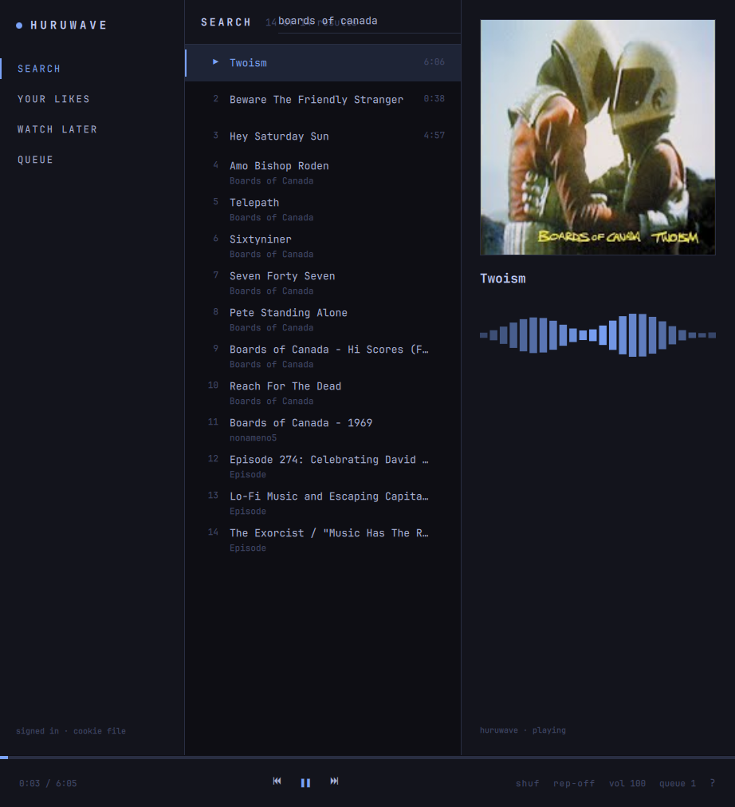

# huruwave

An Omarchy-native music player: YouTube Music, Apple Music and local
files in one window that follows the desktop theme.




- **An embedded Chromium (QtWebEngine) for exactly one job**: Apple Music's full,
  DRM-protected tracks, which mpv cannot play because it cannot load a Widevine CDM
  at all. It is the only surface in the app that is not mpv, it is opt-in
  (`-DHURUWAVE_APPLE_WEB=ON`; the package turns it on), and it carries no CDM and no
  credentials: it points the web engine at the CDM a browser on the machine already
  downloaded, and opens Apple's own player with a session borrowed from that browser.

## Running it

```bash
bin/build        # cmake + make into build/huruwave
bin/test         # the Qt Test binary, offscreen
./build/huruwave # the player

./build/huruwave --search "boards of canada"                        # open with results
./build/huruwave --search "aphex twin" --provider apple             # search Apple Music
./build/huruwave --search "aphex twin" --no-window --json           # headless, for scripts
./build/huruwave --search "aphex twin" --provider apple --no-window # headless, Apple
./build/huruwave --playlist LM                                      # your Liked Music
./build/huruwave --cookies-status                                   # is the session real?
./build/huruwave --widevine-status                                  # can it play full Apple tracks?
./build/huruwave --apple-web 'https://music.apple.com/gb/album/...?i=...'  # full track, in-window
./build/huruwave ~/Music/track.flac                                 # play a local file
./build/huruwave https://music.youtube.com/watch?v=4CE29HLQSnk      # play a URL
```

`bin/build` writes into `build/`. On Hurunagus it is already installed from its own
COPR (`wegweg7979/huruwave`) and cava ships in the image, so there is nothing to
build there — just run `huruwave`.

## Shortcuts

| Key | Action |
|---|---|
| `Space` | play / pause |
| `←` `→` | seek 5 seconds |
| `Ctrl` + `←` `→` | previous / next track |
| `Ctrl` + `L` | jump to the search box |
| Click a row | play it, and load that list as the queue |
| `F` | the full track of an Apple preview, in-window (needs the DRM surface) |
| Drop files | queue local files |
| `?` | the shortcut list |
| `Ctrl` + `Q` | quit |


Album art shown in the screenshot comes from Apple's catalog artwork
(`is1-ssl.mzstatic.com`), the same URLs the search results use.

## License

MIT.
